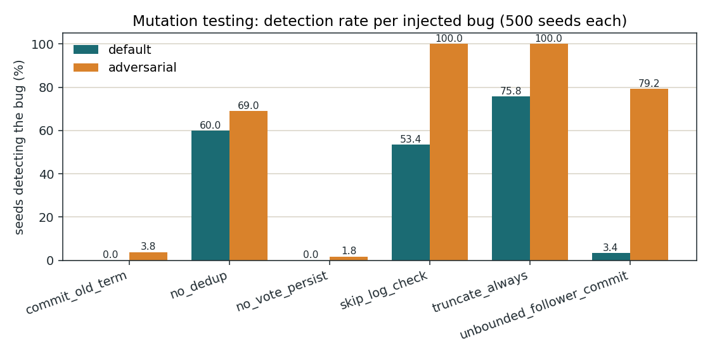
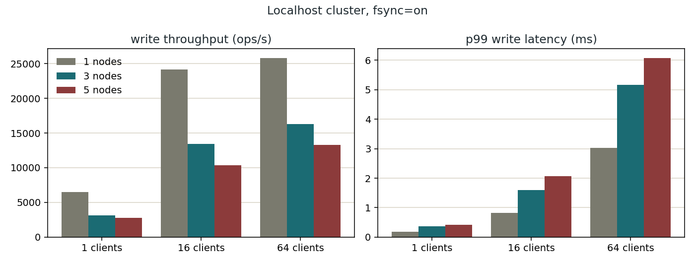
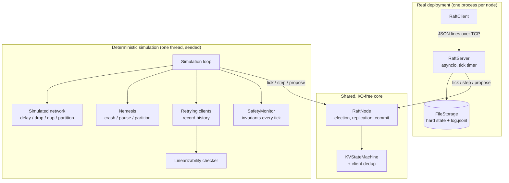

# raft-kv-sim

A Raft-replicated key-value store in Python, tested with a deterministic
fault-injection simulator, an online safety monitor and a linearizability
checker. The same consensus code runs both as real processes over TCP and
inside the simulator, where thousands of seeded crash, partition, pause and
packet-loss schedules run in seconds and any failure replays exactly.

The project also measures the test harness itself. Six realistic Raft bugs
can be switched on one at a time (mutation testing), and the reports show how
often the simulator catches each one.

## Key results

All numbers below are copied from the JSON files in `reports/`, produced by
`scripts/sim_campaign.py` and `scripts/bench_cluster.py` on an Apple M5
(10 cores, macOS, Python 3.11).

**Safety campaign** (`reports/sim_campaign.json`): 7 fault profiles x
{3, 5} nodes x 300 seeds = **4,200 simulated runs, 0 failing** (no safety
violations, every history linearizable, 0 inconclusive checks).

| Profile (5 nodes) | Completed ops / 1k ticks | p50 latency (ticks) | p99 latency (ticks) | Leaders elected per run |
|---|---|---|---|---|
| clean | 388.41 | 8 | 11 | 1.0 |
| crashes | 282.83 | 10 | 57 | 4.72 |
| pauses | 298.4 | 10 | 51 | 4.03 |
| partitions | 260.2 | 10 | 78 | 8.63 |
| elections | 122.63 | 14 | 168 | 19.7 |
| lossy | 90.13 | 26 | 168 | 1.03 |
| chaos | 86.67 | 23 | 230 | 8.82 |

**Mutation testing** (`reports/mutation.json`): percentage of 500 seeds in
which each injected bug is detected. "default" = chaos profile, 5 nodes,
PreVote on, batch 64. "adversarial" = elections profile, 3 nodes, PreVote off,
batch 1.

| Injected bug | default | adversarial | First checker to fire |
|---|---|---|---|
| none (correct code, false-positive check) | 0.0% | 0.0% | - |
| `skip_log_check` (no election restriction) | 53.4% | 100.0% | leader completeness |
| `truncate_always` (follower truncates on every append) | 75.8% | 100.0% | leader completeness |
| `unbounded_follower_commit` (commit past verified entries) | 3.4% | 79.2% | state machine safety |
| `no_dedup` (client retries applied twice) | 60.0% | 69.0% | linearizability |
| `commit_old_term` (Figure 8 bug) | 0.0% | 3.8% | leader completeness |
| `no_vote_persist` (vote lost on crash) | 0.0% | 1.8% | election safety |

Two bugs are invisible in the default configuration and rare even in the
adversarial one. That is a real finding, not noise: they need a narrow
interleaving (for example, a node must crash and restart between two vote
requests in the same term), and the no-op-on-election entry plus batching
hides the Figure 8 bug almost completely. At 3.8% per seed, 100 seeds find
the Figure 8 bug with probability about 98%, so the adversarial profile
should be part of any campaign.

**Ablations** (`reports/ablation.json`, 5 nodes, 300 identical seeds per variant):

| Variant | Profile | Leaders elected per run | Messages per completed op | Completed ops / 1k ticks |
|---|---|---|---|---|
| default (PreVote, batch 64) | partitions | 8.63 | 27.06 | 260.2 |
| PreVote off | partitions | 13.29 | 27.25 | 249.96 |
| batch size 1 | partitions | 8.72 | 35.78 | 243.82 |
| default (PreVote, batch 64) | chaos | 8.82 | 56.69 | 86.67 |
| PreVote off | chaos | 15.39 | 57.76 | 81.92 |
| batch size 1 | chaos | 8.65 | 72.79 | 78.83 |

PreVote cuts needless elections by 35% (partitions) to 43% (chaos);
batching cuts messages per operation by 24% (partitions) and 22% (chaos).

**Real cluster on localhost** (`reports/cluster_bench.json`, separate
processes, fsync on, closed-loop writers, 5 s per cell). The 1-node cluster
is the no-replication baseline.

| Nodes | Clients | Writes/s | p50 ms | p99 ms |
|---|---|---|---|---|
| 1 | 1 | 6503.0 | 0.15 | 0.185 |
| 1 | 64 | 25835.7 | 2.422 | 3.026 |
| 3 | 1 | 3113.1 | 0.319 | 0.366 |
| 3 | 16 | 13458.8 | 1.167 | 1.588 |
| 3 | 64 | 16310.9 | 3.861 | 5.172 |
| 5 | 64 | 13297.8 | 4.761 | 6.083 |

Leader failover (3 nodes, `kill -9` on the leader under load, 5 trials):
median write gap **255.4 ms** (min 186.7, max 343.4), consistent with the
150-300 ms election timeout. Replication costs about half the throughput of a
single node at one client and 37% at 64 clients, because batching amortises
the extra round trip. Note that on macOS `fsync` does not force the drive
cache (`F_FULLFSYNC` would), so absolute latencies are optimistic.




## Architecture



## How it works

* **Consensus.** `RaftNode` implements leader election with randomised
  timeouts, log replication with the consistency check, commit by majority
  restricted to current-term entries, a no-op entry on election, PreVote,
  fast log backtracking with `conflict_index`, optimistic pipelining and
  vote/RPC retransmission. It has no clock, sockets or disk: drivers call
  `tick()`, `step(msg)` and `propose(cmd)` and drain an outbox.
* **State machine.** A key-value store with `put`, `get`, `cas` and `delete`.
  Every command carries `(client, seq)`, and a dedup table inside the
  replicated state turns retried requests into exactly-once effects.
  Reads go through the log, so they are linearizable.
* **Simulator.** One thread, a logical clock and a priority queue of
  messages. Every random choice comes from a seeded generator. Profiles
  combine message loss, duplication, reordering, partitions (including
  isolating the leader), crash/restart with durable storage, and process
  pauses. After the fault window, everything heals so pending operations can
  finish.
* **Checkers.** `SafetyMonitor` uses the simulator's global view to check
  election safety, state machine safety, leader completeness and log matching
  as the run proceeds. `check_history` runs a memoised Wing-Gong search per
  key over the client-observed history. Operations with lost replies may take
  effect at any point after they were sent, or not at all.
* **Real server.** An asyncio TCP server per node with a 10 ms tick,
  file-backed storage and a coalesced flush, so all proposals from one event
  loop iteration share one `AppendEntries` per follower.

## Tech stack

Python 3.9+ standard library only at runtime (asyncio, json, heapq).
pytest for tests and matplotlib for charts. Docker and docker compose for a
containerised 3-node cluster. GitHub Actions CI tests on Python 3.9, 3.11 and
3.12, runs a 100-seed simulation campaign and builds and smoke-tests the
Docker image.

## Setup and usage

```bash
python -m venv .venv && source .venv/bin/activate
pip install -r requirements-dev.txt
pip install -e .
```

Run a local 3-node cluster and talk to it (in a second terminal):

```bash
raftkv cluster --nodes 3
raftkv put greeting hello
raftkv get greeting
raftkv cas greeting hello world
raftkv status
```

Run simulations:

```bash
raftkv sim --seeds 200 --profile chaos            # campaign, prints failing seeds
raftkv sim --seeds 200 --profile elections --nodes 3 --no-pre-vote --max-batch 1 --bug no_vote_persist
raftkv sim --seed 26 --profile elections --nodes 3 --no-pre-vote --max-batch 1 --bug no_vote_persist --trace
```

The last command replays one failing schedule event by event.

Reproduce the reports:

```bash
python scripts/sim_campaign.py --seeds 300 --mutation-seeds 500
python scripts/bench_cluster.py --duration 5 --trials 5
```

Docker:

```bash
docker compose up --build
docker compose exec n0 raftkv get --cluster n0=n0:7000,n1=n1:7000,n2=n2:7000 greeting
```

Tests:

```bash
pytest
```

## Project structure

```
src/raftkv/
  node.py               Raft state machine (election, replication, commit, PreVote)
  messages.py           RequestVote / AppendEntries and their replies
  storage.py            MemoryStorage (simulator) and FileStorage (fsync, atomic rename)
  kv.py                 key-value state machine with client dedup
  sim.py                deterministic simulator, fault profiles, nemesis, clients
  checker/invariants.py online Raft safety checks
  checker/linearizability.py  memoised Wing-Gong checker
  server.py             asyncio TCP server around RaftNode
  client.py             leader-following, retrying client
  cli.py                raftkv command
scripts/                campaign and benchmark scripts that write reports/
reports/                JSON results and charts
tests/                  unit, checker, simulator and TCP integration tests
WALKTHROUGH.md          design notes and study guide
```

## Limitations

* No snapshots or log compaction: the log grows without bound and a
  restarted node replays it from the beginning.
* Fixed membership: no joint consensus or single-server changes.
* Reads go through the log; there is no ReadIndex or lease-based read path,
  so reads cost as much as writes.
* The simulator tests the consensus logic, not the TCP code or real disk
  semantics; those are covered only by integration tests and benchmarks.
* The linearizability check has a state budget (300,000 states per key). No
  run in the reports hit it, but very long or highly concurrent histories
  could come back inconclusive.
* Benchmarks are on one machine over loopback, so network latency is close
  to zero and the leader's Python event loop is the main bottleneck.
* Mutation detection rates depend on the fault profile; a 0% rate for a bug
  in one configuration does not mean the harness can never find it.

## License

MIT, see `LICENSE`.
